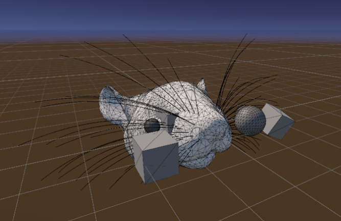

# Unity Whisker Environment

A Unity environment for simulating whisker-based sensing and collecting visual and tactile data. The scene brings together a 3D mouse head, animated whiskers, eye cameras, and nearby objects to study how contact and vision describe the same surroundings.

**Built with:** Unity 6 · C# · Universal Render Pipeline · Python

## Main features

- **Whisker motion:** replays recorded trajectories with interpolation between poses.
- **Contact detection:** tracks where whiskers touch objects during a sweep.
- **Visual capture:** records the scene from the right-eye camera as 64 × 64 grayscale images.
- **Dataset generation:** pairs images with tactile CSVs, with seeded object placement, metadata, and ZIP batching for larger runs.

The current recording pipeline uses 30 right-side whiskers across 51 poses per trial. Scene objects, camera settings, and trial parameters can be adjusted in the Unity Editor.

## Getting started

1. Open the project in **Unity 6000.0.35f1**.
2. Open `Assets/Scenes/ShapeNetScene.unity`.
3. Set a small trial count and a fresh output directory on `TrialManager`, then enter Play Mode. The saved scene is configured for 100,000 trials.

## Project layout

- [Assets/Scripts](Assets/Scripts) — whisker animation, collisions, head movement, and recording.
- [Assets/Scenes](Assets/Scenes) — Unity environment scenes.
- [Assets/Editor](Assets/Editor) — launchers and validation utilities.
- [Tools](Tools) — Python dataset checks and supporting scripts.
